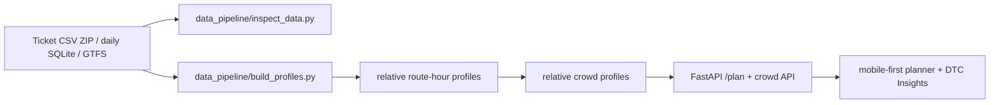

# 🚌 Delhi Ki Public

> **Know the crowd before you board.**

Delhi Ki Public is a crowdedness-aware Delhi bus journey planner for the Transport Stack Hackathon 2026. Crowd estimates are **relative**: ticketing covers only about 3–4% of real bus tickets, so scores compare route, segment, time band and day type; they are not passenger counts.

## Map

The planner uses Leaflet with real OpenStreetMap street tiles, route shapes, stop markers, and live bus markers. Leaflet assets are vendored under `frontend/vendor/leaflet`; map tiles are loaded online and attributed on the map. The default OpenStreetMap tile service has a usage policy and is suitable for light interactive use; for a public production deployment with regular traffic, configure a dedicated tile provider or host tiles rather than relying on community tiles. See the [Leaflet quick start](https://leafletjs.com/examples/quick-start/) and [OpenStreetMap tile policy](https://operations.osmfoundation.org/policies/tiles/).

## Quick start

```bash
python -m venv .venv && . .venv/bin/activate
pip install -r requirements.txt
make run
```
Open http://localhost:8000. The committed ticket and validation profiles are ready to use. `make run` builds the local GTFS SQLite index (about 433 MB) automatically on first launch. No API keys are needed for scheduled bus planning.
Run `make inspect` to regenerate the schema and sample data report at `data_report.json` (ignored by Git because source samples can contain identifiers).
To build the chronological crowd-rank validation report, run `make validation`; it trains on October 1–21 and holds out October 22–28. To build the historical GPS speed baseline, place the verified October GPS archive at `data/raw/delhi-dtc-bus-gtfs-rt-2026-10.7z` and run `make gps`; the default processes only October 1–7, one SQLite database at a time.

## October ticket data

The committed profile in `data/processed/crowd_profiles.json` aggregates
2,559,897 usable October 2026 ONDC ticket rows into route, hour, and
weekday/weekend relative activity scores. To rebuild it, download the ticket
archive from the [hackathon data bucket](https://pub-091bd9e794bb4877b10b29e6df80f065.r2.dev/2026-10/October-Delhi.csv.zip),
place it at `data/raw/October-Delhi.csv.zip`, and run `make profiles`.
The static bus GTFS v32 archive is committed at
`data/raw/delhi_buses_static_gtfs_v1.zip`; `make gtfs` builds its local SQLite
index. The 433 MB generated index and the 64 MB ticket archive stay out of Git.

This is a grouped statistical baseline, not a trained ML model. It exposes
route crowd profiles, morning route insights, and hour-of-day trends from ticket
records. Crowd values are relative percentiles within the sample and must not
be read as passenger counts. The planner uses GTFS stop names, service
calendars, scheduled trips, transfers, and route shapes. Scheduled durations do
not account for traffic or delays. The `/live/route/{route}` endpoint decodes
authorized Delhi OTD GTFS-RT positions when `OTD_API_KEY` is set. Copy
`.env.example` to `.env` and add the key. `.env` is ignored by Git. GPS history
is processed into historical route/hour speed baselines with `make gps`. The
pipeline extracts one daily SQLite file at a time from the public archive and
keeps only the small `data/processed/gps_speed_profiles.json` result. Median
reported speeds are shown on matching journey legs with their sample counts.
They are historical sampled speeds, not live traffic, schedule delay, or
guaranteed journey times. GPS trip IDs do not consistently match scheduled
GTFS trip IDs, so the app does not claim exact historical delay predictions.
Route details also show sampled ticket origin–destination pairs for the selected
bus route and time band. These describe ticket activity, not onboard occupancy
or seat availability. A usual journey is saved in the browser's local storage
on that device and is restored on the next visit; it is not uploaded to the API.
The optional crowd alert requests browser notification permission and checks the
saved journey's historical ticket pattern every 30 minutes while the planner tab
is open. It is not a live crowd alert or a background push notification.

Useful endpoints: `/healthz`, `/data/status`, `/stops?q=...`, `/crowd/trends`,
`/crowd/route/{route}`, `/gps/route/{route}?hour=8&day_type=weekday`,
`/accuracy`, and `/insights`.

## Data and assumptions

The source README describes October 2026 ONDC tickets (`passenger_count`, `amount`, `vehicle_number`, `ticket_type_id`, `end_stop_name`, `route`, `start_stop_name`, `created_at`, `is_ac`) and daily SQLite vehicle feeds with a `vehicle_feed` table. The inspector discovers actual schemas first. The GPS archive is 16.1 GB compressed (124 GB expanded); `make gps` needs the archive at `data/raw/delhi-dtc-bus-gtfs-rt-2026-10.7z` and `py7zr`. It processes only the first seven days, one daily database at a time, and removes each extracted database after aggregation. Bus static GTFS is included; live GTFS-RT is a separate feed.

## Architecture



## Project layout

`data_pipeline/` inspection and processing · `model/` crowd baselines · `routing/` planner · `api/` service · `frontend/` app · `dashboard/` authority insights · `docs/` proposal and demo · `tests/` tests.

## Limitations

Ticket data samples roughly 3–4% of actual tickets; only relative levels should be interpreted. Vehicle numbers are missing for many ticket records. Route detail shows sampled ticket OD pairs, not validated onboard segment loads; the app does not estimate seat availability. Bus route connectivity, schedule times, and shape geometry come from static GTFS, but schedules are not traffic-adjusted and walking-accessible nearby-stop search is not connected. Day profiles distinguish weekdays and weekends; they do not apply a holiday calendar. Historical GPS speeds may be sparse or noisy and only appear for route/hour groups with observations. Live GTFS-RT needs an API key supplied via `.env`; the key is never committed. Ticket-volume anomaly flags do not identify events or weather. No Google Maps travel-time comparison is claimed.

## Docs

- [Phase 1 proposal](docs/phase1-proposal.md)
- [Demo script](docs/demo-script.md)
- API docs: http://localhost:8000/docs

MIT licensed.
