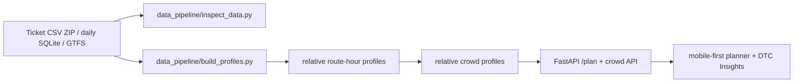

# 🚌 Delhi Ki Public

> **Know the crowd before you board.**

Delhi Ki Public is a crowdedness-aware Delhi bus and metro journey planner for the Transport Stack Hackathon 2026. Crowd estimates are **relative**: ticketing covers only about 3–4% of real bus tickets, so scores compare route, segment, time band and day type; they are not passenger counts.

## Quick start

```bash
python -m venv .venv && . .venv/bin/activate
pip install -r requirements.txt
make run
```
Open http://localhost:8000. The committed ticket profile is ready to use. To enable scheduled bus routing from the committed GTFS feed, run `make gtfs` once before starting the app; this builds a local SQLite index (about 433 MB). No API keys are needed for the available bus planner.

## October ticket data

The committed profile in `data/processed/crowd_profiles.json` aggregates
2,559,897 usable October 2026 ONDC ticket rows into route, hour, and
weekday/weekend relative activity scores. To rebuild it, download the ticket
archive from the [hackathon data bucket](https://pub-091bd9e794bb4877b10b29e6df80f065.r2.dev/2026-10/October-Delhi.csv.zip),
place it at `data/raw/October-Delhi.csv.zip`, and run `make profiles`.
The static bus GTFS v32 archive is committed at
`data/raw/delhi_buses_static_gtfs_v1.zip`; `make gtfs` builds its local SQLite
index. The 433 MB generated index and the 64 MB ticket archive stay out of Git.

This is a grouped statistical baseline, not a trained ML model. It exposes
route crowd profiles, morning route insights, and hour-of-day trends from ticket
records. Crowd values are relative percentiles within the sample and must not
be read as passenger counts. The planner uses GTFS stop names, service
calendars, scheduled trips, transfers, and route shapes. Scheduled durations do
not account for traffic or delays. The `/live/route/{route}` endpoint decodes
authorized Delhi OTD GTFS-RT positions when `OTD_API_KEY` is set. Copy
`.env.example` to `.env`, add the key, and restart the API. `.env` is ignored by
Git. GPS history is downloaded separately for delay and travel-time modelling;
metro routing and AFC crowd estimates still need their respective feeds.

Useful data endpoints: `/data/status`, `/stops?q=...`, `/crowd/trends`,
`/crowd/route/{route}`, and `/insights`.

## Data and assumptions

The source README describes October 2026 ONDC tickets (`passenger_count`, `amount`, `vehicle_number`, `ticket_type_id`, `end_stop_name`, `route`, `start_stop_name`, `created_at`, `is_ac`) and daily SQLite vehicle feeds with a `vehicle_feed` table. The inspector discovers actual schemas first. GPS has gaps/noise and no indexes; process one day at a time. Bus static GTFS is included; metro data and live GTFS-RT are separate feeds and are not connected.

## Architecture



## Project layout

`data_pipeline/` inspection and processing · `model/` crowd baselines · `routing/` planner · `api/` service · `frontend/` app · `dashboard/` authority insights · `docs/` proposal and demo · `tests/` tests.

## Limitations

Ticket data samples roughly 3–4% of actual tickets; only relative levels should be interpreted. Vehicle numbers are missing for many ticket records. Bus route connectivity, schedule times, and shape geometry come from static GTFS, but schedules are not traffic-adjusted and walking access is not estimated. Live GTFS-RT needs an API key supplied via environment. Metro crowd profiles require AFC data. Historical delay modelling still depends on the GPS sample.

## Docs

- [Phase 1 proposal](docs/phase1-proposal.md)
- [Demo script](docs/demo-script.md)
- API docs: http://localhost:8000/docs

MIT licensed.
